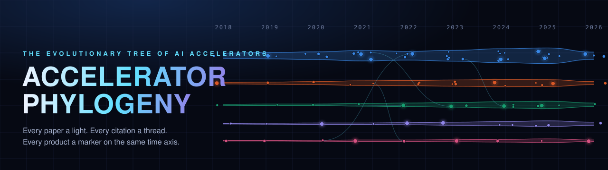
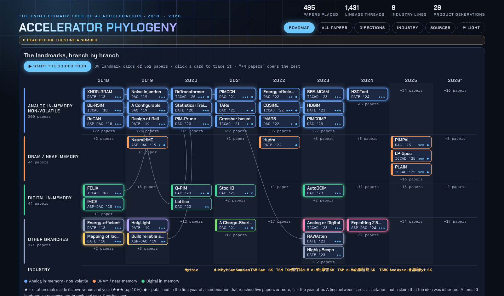
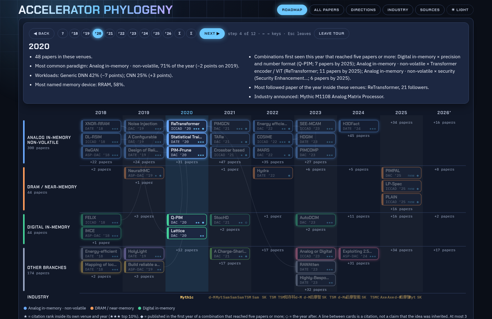
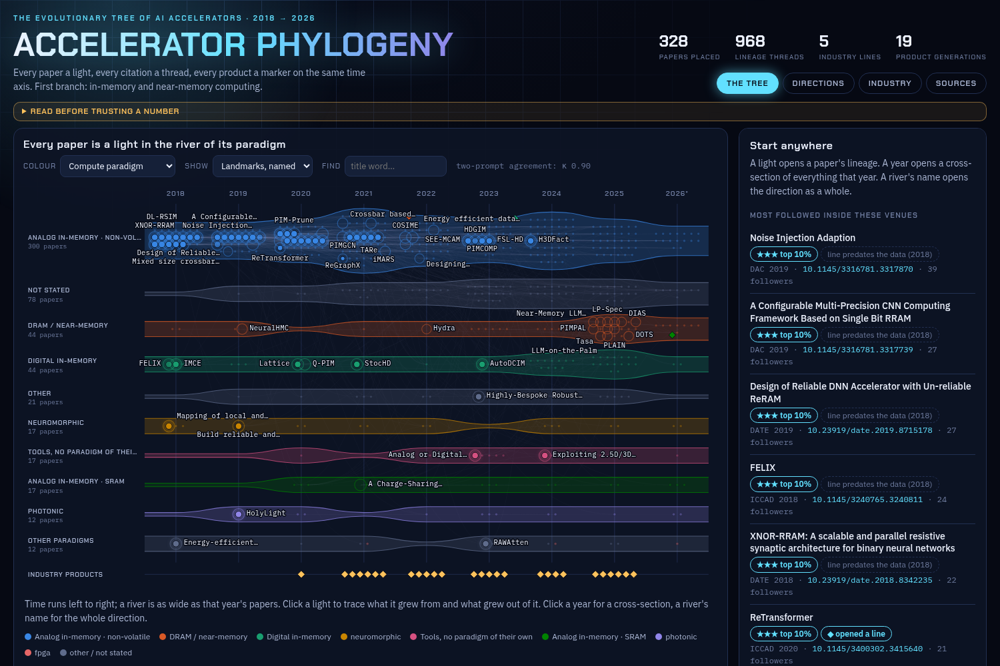
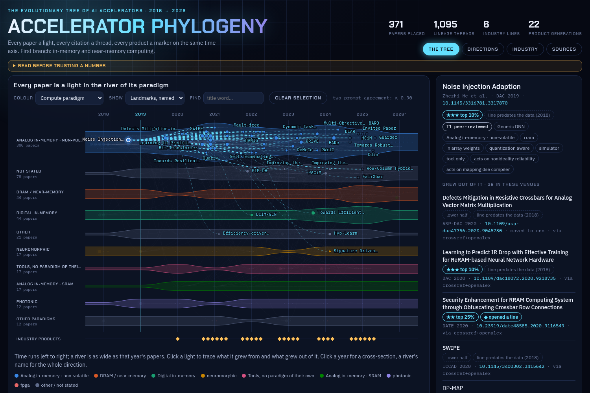
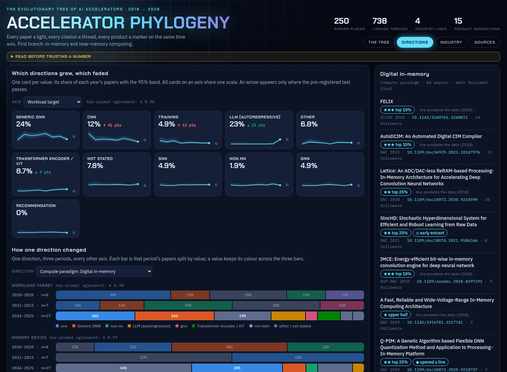
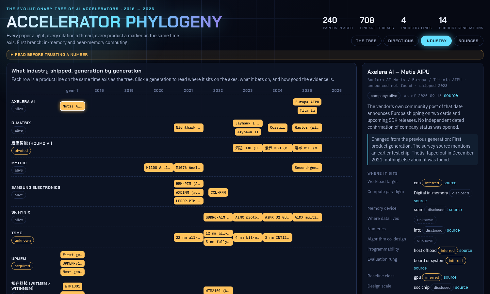

<p align="center">
  
</p>

<p align="center">
  
  
  
  
  
</p>

<h3 align="center">Every paper a light. Every citation a thread. Every product a marker on the same time axis.</h3>

<p align="center">
An interactive map of how AI accelerators have evolved since 2018, built to answer one question:<br>
<b>where is the field going, and what has nobody tried yet?</b>
</p>

---

## See it

Open **`web/index.html`** in a browser. No server, no install.

**The roadmap** shows only the landmarks — about 40 of 562 papers — as named cards on one branch per compute paradigm, drawn at full width so every name is readable. Everything else folds into a “+N papers” tag you can open.

<p align="center"></p>

**The guided tour** walks from 2018 to 2026 one step at a time. Step forward and back with the buttons or the ← → keys, or jump to any year. Every sentence of the narration is assembled from the data: how many papers, which paradigm led and by how much it moved, which combinations appeared for the first time, what industry announced.

<p align="center"></p>

**All papers** keeps the whole population in view: one river per paradigm, one light per paper, landmarks named. Click any light and its lineage lights up — gold threads back to what it grew from, cyan threads forward to what grew out of it.

<p align="center">
  
  
</p>

## What you can do with it

| | |
|---|---|
| **Take the tour** | Walk the field year by year, forward and back, with narration built from the data. |
| **Trace a lineage** | Pick a paper. See what it cites inside these venues, who cited it afterwards, and — when the line left these venues — which fields picked it up. |
| **Cut a cross-section** | Pick a year. See what every paradigm, workload, memory device and lever looked like that year, next to the products industry announced. |
| **Follow one direction** | Pick a direction such as digital in-memory computing and compare its periods side by side: workload, numerics, scale, evaluation rung. |
| **Read a product line** | Generation by generation: where it sits on the same axes as the papers, what it bets on, and how good the evidence is. |
| **Find the outliers** | Every paper carries two marks: ★ influence inside its own venue and year, ◆ whether its combination of ideas was new here. |

<p align="center">
  
  
</p>

## First branch: in-memory computing

The tree is being grown one branch at a time. The first is in-memory and near-memory computing for AI:

- **562 papers** from DAC, DATE, ICCAD and ASP-DAC, 2018–2026, each placed on fixed axes
- **1659 citation threads** inside those venues, merged from three sources
- **9 industry product lines** and 33 generations: Axelera, d-Matrix, Mythic, Samsung HBM-PIM, SK hynix AiM, UPMEM, Houmo, Witmem, TSMC digital CIM macros

Some of what it already shows, with the numbers behind each claim in [`labels/cim_prereg_results.md`](labels/cim_prereg_results.md):

- Analog in-memory computing on non-volatile memory fell by 41 share points between 2018 and 2025; RRAM fell by 46.
- The workload moved: CNN down 41 points, autoregressive LLMs up 23.
- Tile-scale in-memory designs are nearly absent from these venues — on an axis whose labels are below the agreement threshold, so it is a lead to check, not a finding.

## It tells you what it does not know

A trend map is only worth as much as its honesty about its own limits, so the limits are part of the interface.

- **Thresholds were fixed before the data was seen** — hypotheses, kill criteria and every later change are in [`docs/PREREG.md`](docs/PREREG.md). Hypotheses that failed are reported as failed.
- **Labels come from abstracts, by a language model.** Two independently worded prompts were compared; agreement is shown per axis, and axes that cannot be read from abstracts are marked as such.
- **Thin evidence looks thin.** Anything resting on fewer than 10 papers is drawn hatched. 2026 is marked partial.
- **A thread is a citation, not a claim of inheritance.** OpenAlex alone recovered 0.65 of the references checked against full texts; merging three sources brought that to 0.96. "No follower found" can still be a missing record, and the page says so.
- **Every industry number carries its evidence tier** — peer-reviewed, independently measured, vendor claim, or commentary — with its rung and its baseline. Conflicting accounts are shown side by side, not resolved.
- **Legibility is tested, not assumed.** `tests/test_legibility.py` measures the on-screen size and contrast of every kind of text; nothing is under 12 px or below 4.5:1. An earlier version drew card names at 7 px.
- **"Not found" stays on the page.** What was looked for and not found is listed per product line.

## How it is built

```
four-venue corpus ──► keyword slice ──► classifier (2 prompts) ──► labels ──► share tables, trend tests
        │                                                             │
        └──► OpenAlex + Crossref + title matching ──► citation threads ┤
                                                                       ├──► web/data.js ──► the page
industry sources (tiered, with rejects and not-founds) ───────────────┘
```

| Path | Content |
|---|---|
| `web/` | the page (`data.js` is generated) |
| `scripts/` | the pipeline; every step has a verifier |
| `schema/axes.json` | the closed vocabularies |
| `prompts/` | classifier and collection instructions |
| `labels/` | labels and derived tables (DOIs and labels only) |
| `sources/industry/` | one sourced record per product line |
| `docs/` | `PREREG.md` (the contract), `PLAN.md` (status and how to resume), `SOURCES.md` (record format) |
| `tests/` | `python3 tests/test_*.py` — unit tests and a headless-browser check of every view |

To rebuild: copy `config.example.json` to `config.local.json`, set `data_dir` (private working material: API caches, abstracts) and `corpus_index`, then follow [`docs/PLAN.md`](docs/PLAN.md). Abstracts, full texts and API caches are never committed.

## What comes next

Widening from the first branch to the whole tree: every AI-hardware paper in these venues, architecture and circuits venues as a second arm, upstream fields (models, devices, compilers) as parallel lanes, and an idea board that turns gaps into candidate research questions with the filter trail that produced each one.

## Made with

This project is a collaboration between its author and **Claude** (Anthropic's AI model). The author set the question, the requirements and every decision about scope and publication. Claude designed the method with him, wrote the pipeline and the page, ran the classification of abstracts and the collection of industry sources, and carried out the checks reported in the page's Sources tab. The labels are therefore machine labels: the model that produced them is recorded on every label row, and their agreement and limits are stated rather than assumed.

## What it does not claim

Labels are read from abstracts, not full text. Shares are of labelled papers in a year. Citation counts are never compared across years. Precedence inside four venues is not world priority.
